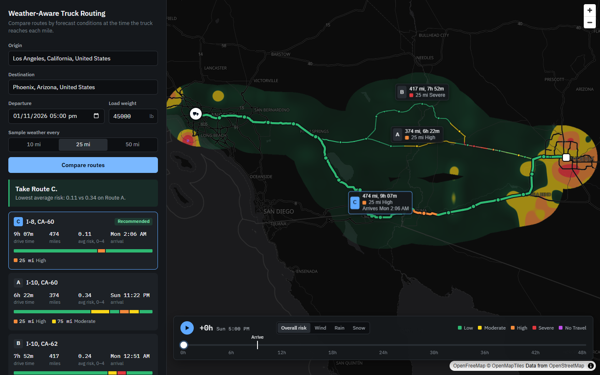
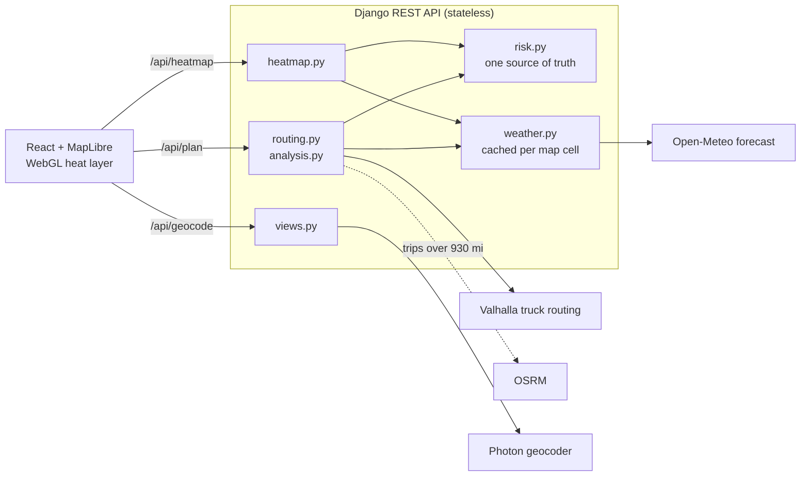

# Weather-Aware Truck Routing

Helps a truck driver choose the safest route. Enter an origin, destination, departure time and load weight, and the app compares three routes using the forecast at the moment the truck reaches each checkpoint.

**Live app:** <https://weather-aware-truck-routing-zeta.vercel.app>

<!-- Add the Loom walkthrough link here. -->



## What it does

- Generates **3 route options** using a truck-aware routing API
- Samples weather every **10, 25 or 50 miles**, using the forecast for the truck's ETA at each checkpoint
- Classifies each checkpoint with the risk table and load rules, and names the condition responsible
- **Recommends a route** and states the criterion that decided it
- Shows all routes, checkpoints, risk levels, ETAs and route summaries on the map
- Shows a **corridor weather heatmap with a 0-48 hour slider**, for overall risk or wind, rain and snow separately

## Architecture



All four external services are free and need no API key, so the project runs immediately after cloning. The backend has no database: routes and forecasts are cached briefly in memory.

| Path | Purpose |
| --- | --- |
| [backend/planner/risk.py](backend/planner/risk.py) | Risk table and load rules as pure functions |
| [backend/planner/analysis.py](backend/planner/analysis.py) | Checkpoints, ETAs, route summaries, recommendation |
| [backend/planner/routing.py](backend/planner/routing.py) | Valhalla and OSRM clients, finding 3 distinct routes |
| [backend/planner/weather.py](backend/planner/weather.py) | Open-Meteo client, time interpolation, caching |
| [backend/planner/heatmap.py](backend/planner/heatmap.py) | Corridor forecast field |
| [frontend/src/map/heatLayer.ts](frontend/src/map/heatLayer.ts) | WebGL heatmap layer |
| [frontend/src/map/routeLayers.ts](frontend/src/map/routeLayers.ts) | Route and checkpoint map layers |

## How the result is calculated

**Routes.** Valhalla's truck profile is the primary source. It uses gross weight (load plus 35,000 lb tare) and a 65 mph top speed. Routers don't always return three alternatives, so the app adds via points offset from the trip midpoint until it has three. Near-duplicates (over 90% overlap) and detours over 1.6 times the fastest time are rejected.

**ETAs.** Each checkpoint's ETA comes from the router's per-segment drive times, not distance divided by average speed.

**Weather at a checkpoint.** The forecast is read at the truck's ETA there, not at departure. Wind is interpolated between hourly readings. Rain and snow come from the hourly total covering that moment.

**Risk.** A checkpoint takes the worst class among wind, rain and snow, after the load rules. Each checkpoint represents the route halfway to its neighbours on either side, so per-class miles add up to exactly the route length. Average risk is distance-weighted on a 0-4 scale.

**Recommendation.** Routes are compared in this order:

1. Fewest No Travel miles
2. Fewest Severe miles
3. Fewest High miles
4. Lowest average risk (within 0.1 counts as a tie)
5. Shortest travel time

## Decisions where the brief left room

| Question | Decision | Reason |
| --- | --- | --- |
| Value on a shared edge, such as rain of exactly 0.25 | Takes the higher class | The safer reading. The top edge stays Severe because No Travel is strictly `>1.00` and `>3.0` |
| Wind between bands, such as 34.6 mph | Bands are half-open: `[25, 35)` | Every real value lands in exactly one class |
| Where No Travel ranks | Above Severe miles | The brief doesn't rank it, but a forbidden route can't beat an allowed one |
| Every route has No Travel miles | Shows the least bad route and says to delay departure | The driver should see a clear warning, not a normal recommendation |
| Near-equal average risk | Within 0.1 is a tie | A strict comparison chose a route 3 hours slower over 0.03 vs 0.07 on New York to Los Angeles, far below forecast precision. Set `AVERAGE_RISK_TIE = 0` in [analysis.py](backend/planner/analysis.py) for a strict ordering |
| Sustained wind or gusts | Sustained wind sets the class; gusts are shown | The thresholds read as sustained speeds, and classifying on gusts would flag far more routes |
| Rain measure | `rain` + `showers` | Open-Meteo reports convective showers separately |
| Slider time base | Hours after departure | It stays useful for future departures, and the truck marker can show where the truck is at that hour |

## Heatmap performance

All 49 forecast hours are uploaded to the GPU once, as a texture array. Moving the slider writes one shader uniform, so there is no network request, texture upload or React render. The shader blends adjacent hours, so time moves continuously instead of stepping.

Measured on the live site, dragging across all 48 hours at 1920x1080 on a GTX 1660 SUPER, over 241 frames:

| Frame time | Result |
| --- | --- |
| Median | 2.8 ms |
| 99th percentile | 3.8 ms |
| Worst frame | 6.1 ms |

The 60 fps budget is 16.7 ms. The slider's own JavaScript takes about 0.2 ms per tick.

Heatmap colours come from scores computed by the same `risk.py` code as the checkpoints, so no threshold is repeated in the frontend. A test confirms each score always falls in the class its checkpoint would get. Interpolation passes through the forecast points and is clamped so it can't show a higher class than the surrounding data.

## Running locally

Requires Python 3.11+ and Node 20+.

```bash
# API, on port 8010
python -m venv .venv
source .venv/bin/activate        # Windows: .venv\Scripts\activate
pip install -r requirements.txt
cd backend && python manage.py runserver 127.0.0.1:8010

# Frontend, on port 5183, in a second terminal
cd frontend
npm ci
npm run dev
```

Open <http://127.0.0.1:5183>. No environment variables are needed.

| Optional variable | Purpose |
| --- | --- |
| `OPEN_METEO_API_KEY` | Commercial Open-Meteo key. Also set `OPEN_METEO_URL` to the customer host |
| `VALHALLA_URL`, `OSRM_URL`, `PHOTON_URL` | Point at self-hosted services |
| `DJANGO_SECRET_KEY`, `DJANGO_DEBUG` | Standard Django settings |

## Tests

```bash
cd backend && python manage.py test    # risk edges, load rules, ranking, sampling, routing, API
cd frontend && npm test                # map geometry
cd frontend && npm run build           # includes the type check
```

Every threshold edge in the brief has its own backend test. Upstream services are mocked, so the tests run offline.

## Deployment

[vercel.json](vercel.json) builds the frontend as static files and serves Django as a Python function through [api/index.py](api/index.py). Run `vercel` from the repository root. No environment variables are required.

## Known limitations

- **Trips over 930 miles use a car profile.** The public Valhalla server has a 1,500 km limit, so these fall back to OSRM, and the app says so on screen. A self-hosted Valhalla would remove the limit.
- **ETAs assume continuous driving.** Hours-of-service breaks aren't modelled. A long trip's real arrival is later, so its forecast times would shift.
- **Times follow the browser's time zone,** and the checkpoint table labels which one.
- **The free forecast tier allows 600 location lookups per minute.** One trip uses 560 at most. The heatmap retries if the quota runs out, and setting `OPEN_METEO_API_KEY` removes the limit.
- **Fewer than 3 routes can appear** where the roads don't allow three distinct options, such as a trip along a single highway with no alternative.
- **Departures are limited to 7 days ahead,** so the whole trip stays inside a usable forecast.
- **The heatmap grid gets coarser on long trips,** from about 8 miles to about 50 miles between points, to stay within that quota.
